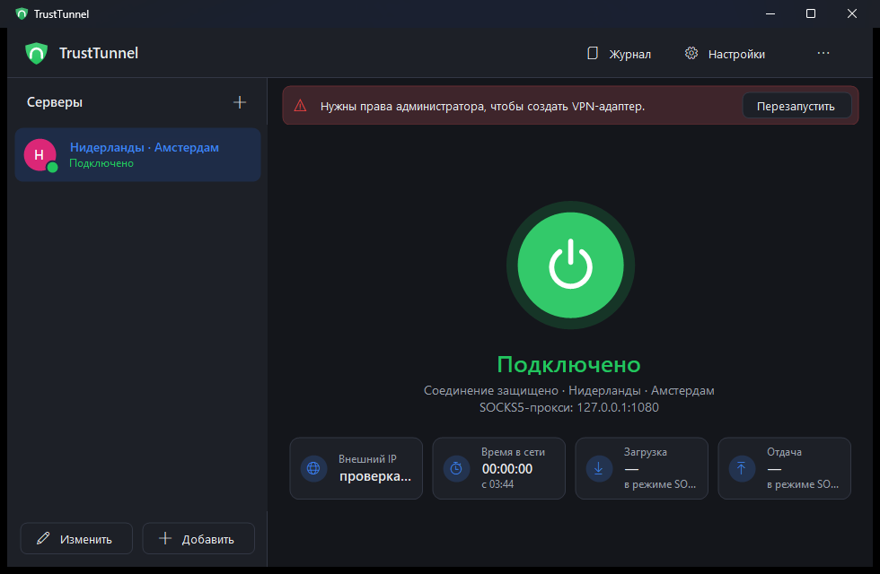
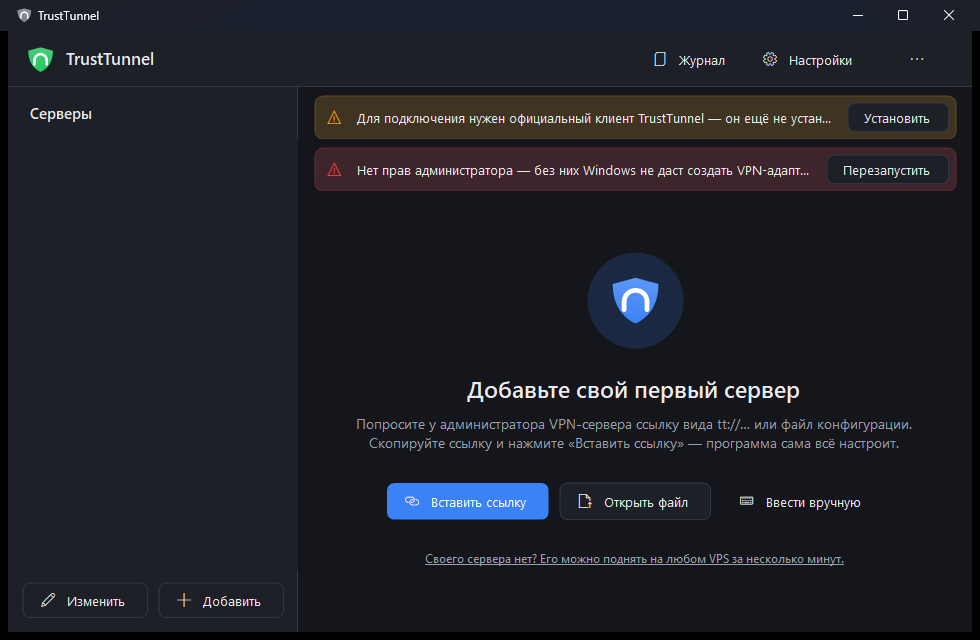
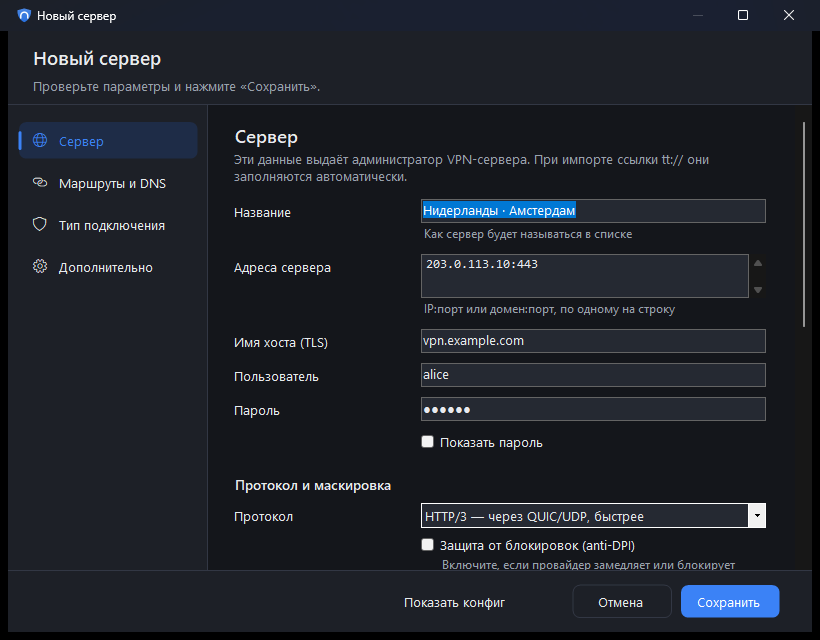

# TrustTunnel GUI

Графический VPN-клиент для Windows под протокол [TrustTunnel](https://trusttunnel.org/): одна кнопка «Подключить», серверы карточками, живая статистика, тёмная и светлая тема.

TrustTunnel — открытый VPN-протокол от AdGuard. Он работает поверх HTTPS (HTTP/2 или HTTP/3), поэтому трафик похож на обычный веб и хорошо проходит через DPI.
Само соединение устанавливает официальный [`trusttunnel_client`](https://github.com/TrustTunnel/TrustTunnelClient), а программа даёт ему удобный интерфейс.



## Установка

Откройте **PowerShell** и выполните:

```powershell
irm https://raw.githubusercontent.com/un1t-h/trusttunnel-gui/main/install.ps1 | iex
```

Скрипт скачает последнюю версию, положит её в `%LOCALAPPDATA%\Programs\TrustTunnelGUI` и создаст ярлыки «TrustTunnel» в меню «Пуск» и на рабочем столе.
Повторный запуск той же команды обновляет программу.

Можно и вручную: скачайте `TrustTunnelGUI.exe` со страницы [Releases](https://github.com/un1t-h/trusttunnel-gui/releases/latest) и запустите.
Устанавливать ничего не нужно, хватит Windows 10/11 со встроенным .NET Framework 4.8.

## Первый запуск

1. Запустите TrustTunnel. Windows попросит права администратора: без них нельзя создать VPN-адаптер.
2. Программа предложит скачать официальный клиент TrustTunnel (`trusttunnel_client` + `wintun.dll`) с GitHub — согласитесь.
3. Нажмите **«Вставить ссылку»** и вставьте ссылку `tt://…`, которую дал администратор сервера. Подойдёт и файл `.toml`.
4. Нажмите большую кнопку — готово. Внизу появятся внешний IP, время в сети и скорость.

| Первый запуск | Редактор сервера |
|---|---|
|  |  |

Своего сервера нет? Его можно поднять на любом VPS по [инструкции TrustTunnel](https://github.com/TrustTunnel/TrustTunnel#quick-start).
Удобно управлять сервером и пользователями из веб-панели [TrustTunnel Panel](https://github.com/un1t-h/trusttunnel-panel).

## Возможности

- **Подключение одной кнопкой.** Состояние описано простыми словами: «Подключено», «Подключение…», «Трафик идёт мимо VPN».
- **Проверка, что VPN действительно работает.** Программа следит, что маршрут в интернет идёт через туннель, и показывает внешний IP.
  Если трафик идёт мимо, она об этом скажет. Перед подключением предупреждает, если включён другой VPN (AmneziaVPN, WireGuard и т. п.).
- **Несколько серверов.** Импорт из ссылки `tt://`, файла `.toml`, буфера обмена (Ctrl+V) или перетаскиванием. Экспорт в ссылку `tt://` для телефона.
- **Все параметры клиента**: HTTP/2 или HTTP/3, anti-DPI, TLS-отпечаток, сертификат, режим маршрутизации и исключения, kill switch, DNS (DoH/DoT/DoQ), TUN или SOCKS5, MTU.
- **Трей**: значок меняет цвет по состоянию, из меню можно подключиться и переключить сервер.
- **Автопереподключение** при обрыве, подключение при запуске, автозапуск вместе с Windows, открытие ссылок `tt://` из браузера.
- **Безопасность**: пароли хранятся зашифрованными через Windows DPAPI. Конфиг с паролем пишется на диск только на время подключения.
  Отключение идёт через Ctrl+C, чтобы клиент сам вернул маршруты и DNS.
- **Журнал** подключения в окне (Ctrl+L) и в файле `%APPDATA%\TrustTunnelGUI\logs`.

## Сборка из исходников

Ничего устанавливать не нужно: используется компилятор C#, встроенный в Windows.

```powershell
powershell -ExecutionPolicy Bypass -File .\build.ps1 -Test
```

Результат — `bin\TrustTunnelGUI.exe`. Флаг `-NoElevate` собирает версию без запроса UAC (для отладки интерфейса).
Релизы собираются автоматически через GitHub Actions при публикации тега `v*`.

## Удаление

```powershell
$env:TTGUI_UNINSTALL=1; irm https://raw.githubusercontent.com/un1t-h/trusttunnel-gui/main/install.ps1 | iex
```

## Устройство

| Файл | Назначение |
|---|---|
| `src/MainForm.cs` | главное окно, трей, импорт/экспорт, интеграция с Windows |
| `src/ProfileForm.cs`, `src/SettingsForm.cs` | редактор сервера, настройки |
| `src/Theme.cs`, `src/UiControls.cs` | темы и собственные элементы интерфейса |
| `src/VpnController.cs` | запуск `trusttunnel_client`, состояние, маршрут, остановка |
| `src/ClientInstaller.cs` | скачивание официального клиента и `wintun.dll` |
| `src/DeepLink.cs` | ссылки `tt://` по [спецификации](https://github.com/TrustTunnel/TrustTunnel/blob/master/DEEP_LINK.md) |
| `src/Toml.cs`, `src/ConfigBuilder.cs` | разбор и генерация `trusttunnel_client.toml` |
| `tests/SelfTest.cs` | самопроверка (`build.ps1 -Test`) |

## Лицензия

[MIT](LICENSE). TrustTunnel и `trusttunnel_client` — проекты AdGuard со своими лицензиями. Программа скачивает их с официальных страниц.
